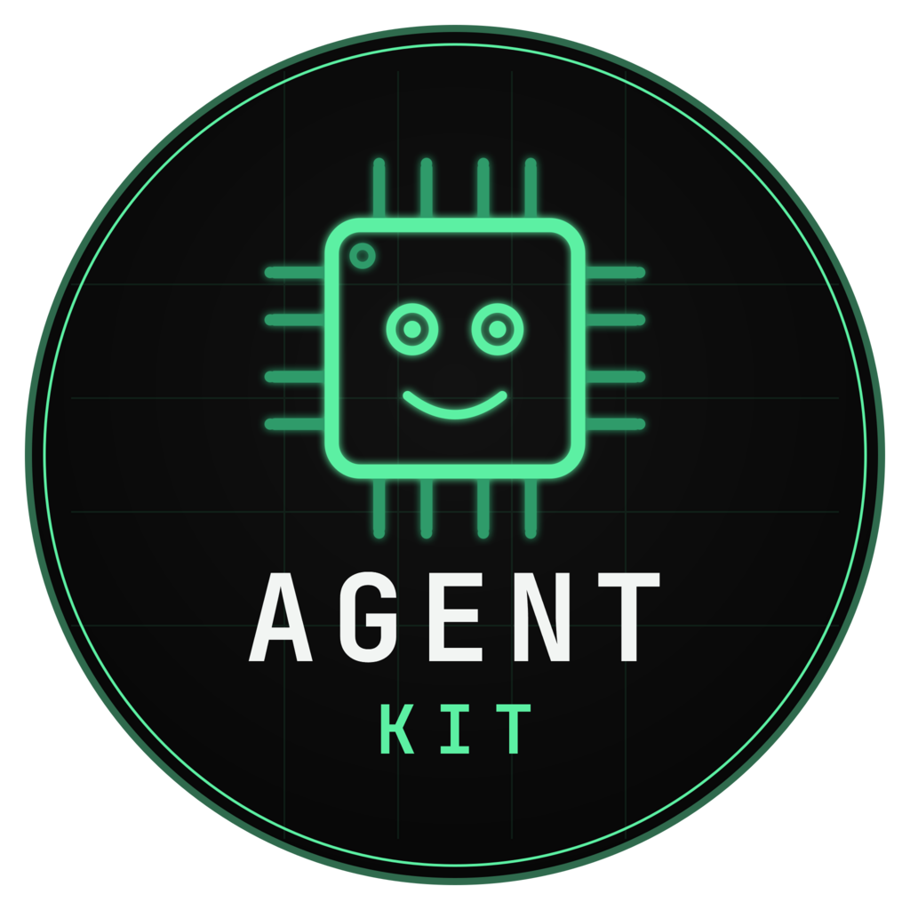

<p align="center">
  <picture>
    <source media="(prefers-color-scheme: dark)" srcset="assets/ai-agent-kit.png">
    <source media="(prefers-color-scheme: light)" srcset="assets/ai-agent-kit-light.png">
    
  </picture>
</p>

# AI Agent Kit

**The canonical, vendor-agnostic source of truth for one workstation's AI-agent assets** —
skills, commands, reusable prompts, agent instructions, workflows, configurations, and
plugin/addon references — across Claude Code, OpenAI Codex CLI, Google Gemini CLI, and any
future vendor, framework, or product.

Every asset is authored once, lives here, and deploys out to a profile or a project. The flow
is always archive → consumer.

## What it is, who it's for

This is an **archive**, not an application. It holds the knowledge modules an AI coding agent
loads to work well in a given domain, and the automation that moves them around.

- **Using an agent CLI?** Take the [Quick start](#quick-start) — install what you need into
  your profile or into one project.
- **Looking for a particular asset?** Browse **[`CATALOG.md`](CATALOG.md)** for skills,
  instructions, commands, and indexed shared assets; browse [`shared/guardrails/`](shared/guardrails/)
  for guardrails, which are not yet included in catalog generation.
- **Adding or changing an asset?** Start with [`CONTRIBUTING.md`](CONTRIBUTING.md), then the
  governance documents below.

## Repository map

> **▣ Diagram —** the directory tree and the archive→consumer flow *(type: tree + flow)* — [view](diagrams/repo-map.html)

```
ai-agent-kit/
├── README.md            # you are here — mission + orientation
├── CATALOG.md           # GENERATED — every asset, every vendor
├── CONTRIBUTING.md      # how to add a skill, a vendor, or a shared asset class
├── manifest.json        # GENERATED — machine-readable source of truth
├── install-skills.ps1   # remote installer; its root path is a published contract
├── claude/              # canonical authoring surface: skills, instructions, commands
├── codex/               # on-demand mirror of the Claude surface
├── gemini/              # frozen mirror
├── shared/              # vendor-neutral: prompts, workflows, configs, plugins, guardrails
├── scripts/             # lifecycle automation — audit, generate, install, sync
└── docs/                # requirements, plans, and binding reorg governance
```

Vendor directories hold assets bound to one CLI's frontmatter contract and install paths.
`shared/` holds everything that is not: plain markdown or config any vendor's agent can read.

## Quick start

> **▣ Diagram —** the three install paths (profile install / project install / direct script install)
> as a decision flow *(type: flow)* — [view](diagrams/install-paths.html)

Pick by scope. A **profile install** lands in your CLI's home directory, so every project can
use the asset. A **project install** copies one bundle into one repository, so it travels with
that repo.

### Into your profile

```powershell
irm 'https://raw.githubusercontent.com/aberrantCode/ai-agent-kit/main/install-skills.ps1' | iex
```

The installer is interactive: pick platform, asset type, deploy paths, then browse and select.
Requires PowerShell 5.1+ on Windows, or `pwsh` on macOS and Linux.

**Know what that one-liner does.** It executes unreviewed code from this repo's `main` branch
as you, with no version pin or integrity check — see [`scripts/README.md`](scripts/README.md)
for the full trust model and lower-trust alternatives.

### Bootstrap a new profile (standard set)

Every new user profile should get the standard setup without the interactive picker.
[`scripts/bootstrap-profile.ps1`](scripts/bootstrap-profile.ps1) does it in one pass:

- **Skills** — `base`, `github`, `project-manager`, `skills-manager`, `statusline` (the
  `standard_skills` list in [`manifest.json`](manifest.json)) plus any `requires:`
  dependencies, each deployed through `push-to-profile.ps1`.
- **Status line** — `~/.claude/statusline.sh`, wired into `~/.claude/settings.json`. A status
  line you already configured is left alone. Needs `bash`, `jq`, and `git` on `PATH`; any that are
  missing are installed with `winget` — `jqlang.jq`, and `Git.Git` for `bash` + `git` (the
  WSL `bash` launcher doesn't count). Pass `-SkipPrereqInstall` to only warn.
- **Default instructions** — `~/.claude/CLAUDE.md`, `~/.codex/AGENTS.md`, and
  `~/.gemini/GEMINI.md`, built from the core rules in
  [`shared/guardrails/`](shared/guardrails/) (the `standard_guardrails` list). A file that
  already exists is skipped, never overwritten.

These steps are written so an agent can follow them as-is:

1. **Find a local clone.** Use the first of these that contains `scripts/bootstrap-profile.ps1`:
   `C:\development\ai-agent-kit`, then `~/development/ai-agent-kit`.
2. **No clone? Get one.** Clone into `~/development/ai-agent-kit` (or
   `C:\development\ai-agent-kit` on this workstation):

   ```powershell
   git clone --branch main https://github.com/aberrantCode/ai-agent-kit.git "$HOME/development/ai-agent-kit"
   ```

   No `git`? Copy it instead — download and extract the `main` archive (no `-Pull` updates
   later; re-download to refresh):

   ```powershell
   $dest = "$HOME/development"; New-Item -ItemType Directory -Force $dest | Out-Null
   Invoke-WebRequest https://github.com/aberrantCode/ai-agent-kit/archive/refs/heads/main.zip -OutFile "$env:TEMP/ai-agent-kit.zip"
   Expand-Archive "$env:TEMP/ai-agent-kit.zip" $dest -Force
   Rename-Item "$dest/ai-agent-kit-main" ai-agent-kit
   ```
3. **Preview, then deploy** (PowerShell 7 — `winget install Microsoft.PowerShell` if `pwsh`
   is missing):

   ```powershell
   pwsh -NoProfile -File <clone>/scripts/bootstrap-profile.ps1          # preview
   pwsh -NoProfile -File <clone>/scripts/bootstrap-profile.ps1 -Force   # deploy
   ```

   Add `-Pull` to fast-forward an existing clone first, `-Vendor codex|gemini` to deploy that
   CLI's skills instead, `-Name a,b` for a different skill set, `-SkipStatusline` /
   `-SkipInstructions` to leave those alone, `-ProfileHome <dir>` to rehearse against a scratch
   directory (add `-SkipPrereqInstall` there — tool installs are machine-wide), and `-Json` for a machine-readable report. Re-running is safe: bundles are backed
   up to `~/.claude/skills-backups/` before being replaced, `settings.json` is backed up before
   it changes, and instruction files are never overwritten. Exit `0` = done, `1` = a bundle or
   rule is missing or failed, `2` = execution error.
4. **Start a new session** — skills and commands load at session start.

### Into a single project

`/install-skill <name> <target-dir>` copies a bundle — `SKILL.md` plus any `sub-skills/`,
`commands/`, `references/`, and `rules/` — into that project's `.claude/`, stamping it
`installed-from: ai-agent-kit`. That slash command is not built into your CLI: it ships with
`skills-manager`, which is itself a skill in this archive. Profile-install it once with the
one-liner above and the command is available everywhere.

For a script-driven install without slash commands, clone the archive and use PowerShell 7:

```powershell
git clone --branch main https://github.com/aberrantCode/ai-agent-kit.git
pwsh -NoProfile -File ./ai-agent-kit/scripts/push-to-profile.ps1 -Name typescript -TargetDir "./your-project/.claude/skills"
pwsh -NoProfile -File ./ai-agent-kit/scripts/push-to-profile.ps1 -Name typescript -TargetDir "./your-project/.claude/skills" -Force
```

Replace `your-project` with the project path. Preview first, then deploy with `-Force`; the
script stamps provenance, relocates companion commands, and backs up an existing bundle.

## The full asset list

**[`CATALOG.md`](CATALOG.md)** — skills, instructions, global commands, and shared prompts,
workflows, configs, and plugin references, with cross-vendor availability for skills.
It is generated from `manifest.json` plus direct scans of commands and those shared classes;
both generated files are produced by `scripts/` and never hand-edited. Guardrails are
currently browsed separately under [`shared/guardrails/`](shared/guardrails/).

No tables or counts appear on this page for the same reason: a number written twice is a
number that drifts.

## Conventions

Skill bundles live at `{vendor}/skills/{name}/SKILL.md`. For the full bundle anatomy —
`sub-skills/`, `commands/`, `references/`, `rules/`, `diagram.html`, `evals/` — see
[`claude/README.md`](claude/README.md). Frontmatter:

```yaml
---
name: my-skill                      # must equal the directory name
description: One-line, trigger-rich summary
category: Foundations & Workflow    # sole source of category truth
status: active                      # active | draft | deprecated  (optional)
version: 1.0.0                      # semver or ISO date           (optional)
requires: [base]                    # dependency list              (optional)
---
```

- **Regenerate, never hand-edit.** Follow any frontmatter or bundle change with
  `python scripts/generate-manifest.py`, then `pwsh ./scripts/generate-catalog.ps1 -Force`.
- **Check your work.** `pwsh ./scripts/audit.ps1` is the read-only health check.
- **Delete superseded assets.** Git history is the archive of record; `deprecated` is a
  transient "scheduled for removal" marker, not a permanent tombstone.
- **Branch, then PR.** Feature branch off `dev`, PR back to `dev`; never push to either
  directly.

## Governance

- [`docs/README.md`](docs/README.md) — documentation index, including feature specs, task
  tracking, workflow references, and status.

- [`CONTRIBUTING.md`](CONTRIBUTING.md) — how to add a skill, a vendor, or a shared asset class.
- [`docs/reorg/charter.md`](docs/reorg/charter.md) — **binding** for anything touching skill
  structure; it wins over everything else here.
- [`docs/requirements/canonical-repo.md`](docs/requirements/canonical-repo.md) — what this
  repo's structure must satisfy, and why.
- [`docs/plans/canonical-repo-plan.md`](docs/plans/canonical-repo-plan.md) — the restructure
  task list and acceptance criteria.
- [`scripts/README.md`](scripts/README.md) — every script, its status, and the full installer
  trust model.
- [`CHANGELOG.md`](CHANGELOG.md) — dated record of merged changes.
- [`ROADMAP.md`](ROADMAP.md) — planned and in-progress work.
